# FitCheck Technical Architecture

## 1. System Overview

**FitCheck** is an enterprise-grade, real-time AI interview simulation and candidate screening platform. It connects candidates with Socratic AI interviewers (e.g. *Marcus Vance*, *Sarah Chen*, *Alex Rivera*) across live, low-latency, bidirectional WebRTC audio channels, dynamically assesses candidate answers against role-specific rubrics, and generates evidence-grounded evaluation scorecards.

```mermaid
flowchart TD
    subgraph Client["Flutter Client (Web / Desktop / Mobile)"]
        UI["Candidate Flightdeck UI\n(Landing, CommandCenter, Jobs/Rubrics, Library, Scorecard)"]
        LiveRoom["LiveInterviewRoomPage\n(Question Spotlight, Observation Stream, Audio Controls)"]
        CSM["CallSessionManager\n(Agora RTC State, Audio Levels, Minimization)"]
        AgoraEngine["Agora RTC Engine\n(Bidirectional 48kHz Voice Audio)"]
        AuthClient["AuthenticatedApiClient\n(Firebase Bearer Auth, 401 Auto-Refresh, Multipart Uploads)"]
    end

    subgraph Backend["FastAPI Backend Service"]
        V1["V1 REST Router (/api/v1)\n(Candidates, Jobs, Interviewers, Sessions, Evaluations, Memories)"]
        Planner["InterviewPlannerService\n(Role, Candidate & Seniority Plan Synthesizer)"]
        Adaptive["AdaptiveInterviewOrchestrator\n(Turn-by-Turn Stage Transitions & Competency Coverage)"]
        Runtime["FitCheckRuntimeService\n(Gemini Live Prompt Compiler & RTC Token Orchestration)"]
        EvalEngine["EvaluationEngineService\n(Evidence-Based Transcript Quote Citation & Bento Scoring)"]
        RubricGen["RubricGeneratorService\n(Assisted Observable Criteria Synthesizer)"]
        ResumeSvc["ResumeExtractorService\n(Structured PDF/Text Candidate Profile Ingestion)"]
        MemRepo["CandidateMemoryRepository\n(Longitudinal Milestone & Practice Fact Retention)"]
    end

    subgraph Persistence["Persistence Layer"]
        DB[(PostgreSQL / SQLite Database)]
        T_Cand["candidates\n(Profile, Skills, Experience, Education)"]
        T_Job["jobs\n(Seniority, Description, Competency Rubrics)"]
        T_Int["interviewers\n(Presets, Voice ID, Style, Provenance)"]
        T_Sess["interview_sessions\n(State, Plan, Transcript, Timing)"]
        T_Eval["interview_evaluations\n(Scores, Quotes, Recommendations)"]
        T_Mem["candidate_practice_memories\n(Milestones, Strengths, Growth Areas)"]
        T_Legacy["archived_*\n(Preserved Legacy Data)"]
    end

    subgraph External["External Cloud AI Infrastructure"]
        Gemini["Google Gemini 2.5 Flash / Gemini Live\n(Plan Generation, Live Speech, Evaluation)"]
        AgoraCloud["Agora RTC SD-RTN & Cloud Agents\n(Sub-100ms Bidirectional Audio Transport)"]
    end

    UI --> LiveRoom
    LiveRoom --> CSM
    CSM --> AgoraEngine
    AgoraEngine <===>|"Bidirectional Audio (RTC)"| AgoraCloud
    UI --> AuthClient
    AuthClient -->|"Bearer Auth REST"| V1

    V1 --> Planner
    V1 --> Adaptive
    V1 --> Runtime
    V1 --> EvalEngine
    V1 --> RubricGen
    V1 --> ResumeSvc
    V1 --> MemRepo

    Planner --> Gemini
    Runtime --> Gemini
    Runtime --> AgoraCloud
    Adaptive --> Gemini
    EvalEngine --> Gemini
    RubricGen --> Gemini
    ResumeSvc --> Gemini

    V1 --> DB
    DB --- T_Cand
    DB --- T_Job
    DB --- T_Int
    DB --- T_Sess
    DB --- T_Eval
    DB --- T_Mem
    DB --- T_Legacy
```

---

## 2. Core Architectural Pillars

### 2.1 Decoupled Real-Time Voice & Reasoning Pipeline
- **Agora RTC SD-RTN**: Ultra-low latency (<100ms global) audio stream transport. The client connects directly to Agora RTC channels for bidirectional communication with speech activity detection, acoustic echo cancellation (AEC), and hardware metering.
- **Google Gemini Live**: Provides real-time speech intelligence, natural conversational inflection, interruptions, and contextual follow-ups without robotic turn-taking pauses.
- **Provider Abstraction**: Voice and LLM providers operate behind clean service contracts (`FitCheckRuntimeService`, `SpeechProvider`, `AgoraService`), allowing alternative models or transcription services to plug in seamlessly.

### 2.2 Dynamic Interview Planning & Socratic Orchestration
- **No Hardcoded Personas**: Personas (*Marcus Vance*, *Sarah Chen*, *Alex Rivera*, custom interviewers) are defined as database models containing voice IDs, questioning styles (`challenging`, `rigorous`, `conversational`), and behavioral directives.
- **Interview Planning**: When a session is initiated (`POST /api/v1/sessions`), `InterviewPlannerService` combines:
  1. The candidate's background, skills, and prior practice weaknesses.
  2. The target job profile, seniority level, and required competencies.
  3. The interviewer's questioning style and voice profile.
  4. The selected difficulty mode (`lenient`, `realistic`, `challenging`, `expert_stress`).
- **Adaptive Execution**: `AdaptiveInterviewOrchestrator` monitors stage transitions (`introduction` -> `experience_deep_dive` -> `technical_assessment` -> `candidate_questions` -> `completed`) and tracks competency coverage dynamically.

### 2.3 Evidence-Based Rubric Evaluation Engine
- When an interview concludes (`POST /api/v1/sessions/{id}/end`), `EvaluationEngineService` processes the complete candidate-interviewer transcript against the job's competency rubric.
- Every competency score (0.0–5.0) is grounded in **exact transcript quotations** (`TranscriptEvidenceCitation`) citing specific turn indices where the candidate demonstrated or failed the criterion.
- Generates a structured Bento scorecard: overall readiness score (0–100%), overall recommendation (`Strong Hire`, `Hire`, `Leaning Hire`, `No Hire`), observed strengths, technical gaps, and preparation recommendations.

### 2.4 Candidate Practice Memory & Multi-Tenant Isolation
- FitCheck maintains longitudinal practice memory across practice sessions.
- `MemoryExtractor` parses completed session transcripts to extract durable technical milestones, demonstrated strengths, and recurring weak spots into `candidate_practice_memories`.
- Subsequent interview plans inject these memories into the interviewer's prompt so Socratic interviewers can challenge recurring weaknesses and assess candidate growth.
- **Tenant Isolation**: Every query in `SQLCandidateMemoryRepository` and other SQL repositories enforces `WHERE user_id = :uid`, preventing any candidate from accessing another candidate's practice history.
- **Privacy Controls**: Candidates can inspect memories and exercise their Right to be Forgotten by deleting individual entries or purging all memories (`DELETE /api/v1/candidate/memories`).

---

## 3. Standalone Architecture & Data Preservation

FitCheck provides a dedicated technical interview platform with non-destructive data preservation:

1. **Active FitCheck Platform**: Primary entry point via `lib/app.dart` (`FitCheckApp` / `FitCheckShell`). All candidate workflows, target jobs, AI rubric generators, resume parsers, Agora live room, and scorecard evaluation dashboards operate through this layer.
2. **Preserved Data Preservation Layer**: `backend/app/db/legacy_migrator.py` mirrors legacy SQLite data into PostgreSQL `archived_*` and `candidate_practice_memories` tables to ensure zero data loss. Interviewer runtime and emotion engines remain functional with clean domain models.
