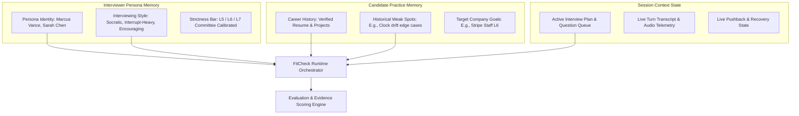

# FitCheck Implementation Tracker

**Repository:** `FitCheck`  
**Design Authority:** Stitch MCP Project (`15552018046722053788`)  
**Design System:** Precision Studio Dark-Mode (`#08090C` Canvas, `#5CE2F6` Primary, `#CEBDFF` Secondary, `#5AE9AC` Tertiary)  
**Status Date:** October 2026  

---

## 1. Candidate Journey: Core 5 Screens (Implemented & Connected)

| # | Screen Name | Stitch ID | Route | Status | Live / Connected Elements | Static / Simulated Mock Elements | Deferred TODOs |
|---|---|---|---|---|---|---|---|
| **1** | **Public Landing Page** | `961c1ec5...` | `/` or `FitCheckRoute.landing` | **Implemented** | • Full responsive hero & top navigation<br>• Persona tabs (`Marcus Vance`, `Sarah Chen`, `Alex Rivera`, `Elena Zhao`)<br>• CTA buttons routing to Candidate Command Center<br>• Sign-in trigger modal | • Simulated audio dBFS graph (-16.8 dBFS)<br>• Hardcoded marketing stats (24ms latency, 14+ drills, 98% realism) | • Connect to live dynamic testimonials and active company track catalog API |
| **2** | **Candidate Command Center** | `14a95e32...` | `FitCheckRoute.commandCenter` | **Connected to Real Persistence** | • Live candidate identity (`candidate?.fullName`, `headline`, `skills`)<br>• Real interview telemetry computed from `sessions` and `evaluations`<br>• Interactive Profile Editing Dialog (`PUT /api/v1/candidates/{id}`)<br>• Honest Empty States when candidate has 0 sessions<br>• Explicit `DEMO MODE` badge when Elena Rostova sample is active<br>• Past sessions column wired to session scorecards | • Speech pacing optimal benchmark (138 WPM optimal target bar)<br>• Practice library drill recommendations | • Longitudinal competency radar chart over 5+ sessions |
| **3** | **Interview Setup & Hardware Readiness** | `89e4fa65...` | `FitCheckRoute.hardwareSetup` | **Connected to Real Persistence** | • 4-tier difficulty selection (`Lenient`, `Realistic`, `Challenging`, `Stress`)<br>• Live session creation via `POST /api/v1/sessions`<br>• Dynamic session plan generation via `InterviewPlannerService`<br>• Real-time mic loopback visualizer (8-band bar anim)<br>• Interactive audio chime test button | • Audio interface name dropdown (Shure MV7 mock)<br>• WebRTC ping (18ms mock) & packet drop (0.0% Opus 48k mock) | • Wire browser/desktop `navigator.mediaDevices.enumerateDevices()` to select real microphone hardware<br>• Ping real Agora/WebSocket backend server for live round-trip latency |
| **4** | **Live Voice Interview Room** | `FitCheckLiveInterviewRoom` | `FitCheckRoute.liveStudio` | **Connected & Operational** | • Production-grade Agora WebRTC connection (`AgoraCallService`)<br>• Real microphone input & remote interviewer audio playback<br>• Real-time scrolling transcript stream with speaker turn commitment<br>• Acoustic telemetry & active speaker visualizer<br>• Mute, Speaker, and Audio Device settings dialog<br>• End interview confirmation modal triggering backend evaluation pipeline | • Simulated in-memory session when exploring via Demo Mode | • Additional acoustic pitch/jitter graph deck |
| **5** | **Evaluation Scorecard** | `ce4d28a2...` | `FitCheckRoute.scorecard` | **Connected to Real Persistence** | • Bento hero with real `FitCheckEvaluation` overall score (0-100)<br>• Dynamic overall recommendation (`Strong Hire`, `Lean Hire`, etc.)<br>• Summary verdict and evidence-backed critique from Gemini<br>• Executive scorecard mapping real competency breakdown<br>• Prescriptive remediation drill recommendation from evaluation | • Acoustic and key moments audio waveform inspection deck | • Multi-tier granular feedback sub-pages |

---

## 2. Infrastructure Classification & Preservation Map

### Category A: Preserved as Reusable Infrastructure
These components constitute the core AI, reasoning, memory, and voice capabilities of the platform. They are preserved intact behind clean service boundaries and tested against regression:

| Component Name | File Path | Persistence Mechanism | Primary Callers / Tests | Proposed FitCheck Destination |
|---|---|---|---|---|
| **InterviewPlannerService** | `backend/app/services/interview_planner.py` | SQLite / PostgreSQL (`session_plan` JSON in `interview_sessions`) | `POST /api/v1/sessions`, `tests/test_v1_api.py` | Future persistent interviewer-persona interrogation planning and dynamic rubric adaptation. |
| **EvaluationEngineService** | `backend/app/services/evaluation_engine.py` | SQLite / PostgreSQL (`interview_evaluations` table) | `POST /api/v1/sessions/{id}/end`, `tests/test_evaluation_engine.py` | Evidence-based scoring engine verifying transcripts against competencies and generating quotes/critiques. |
| **InterviewerPersonalizerService** | `backend/app/services/interviewer_personalizer.py` | SQLite / PostgreSQL (`interviewers` table) | `POST /api/v1/interviewers/{id}/personalize`, `tests/test_interviewer_personalizer.py` | Powers interviewer style synthesis (strictness, socratic pushback, communication style) separating verified career facts from behavioral inference. |
| **MemoryExtractor** | `backend/app/services/memory_extractor.py` | SQLite / PostgreSQL (`candidate_practice_memories`) | `FitCheckRuntimeService`, `tests/test_memory_extractor.py` | Extracts durable candidate facts, preferences, and progress across interviews. |
| **FitCheckRuntimeService** | `backend/app/services/runtime_orchestrator.py` | SQLite / PostgreSQL (`interview_sessions`) | `app/api/v1_router.py`, `tests/test_runtime_orchestrator.py` | Compiles real-time runtime prompt, integrates Agora RTC token service, and coordinates Gemini Live bidirectional audio stream. |
| **AgoraTokenService** | `backend/app/services/agora_token.py` | Ephemeral RTC tokens | `app/api/v1_router.py`, `tests/test_agora_token.py` | Generates secure Agora RTC access tokens for live candidate voice sessions. |
| **ResumeExtractorService** | `backend/app/services/resume_extractor.py` | SQLite / PostgreSQL (`candidates` table) | `POST /api/v1/candidates/resume/text`, `tests/test_resume_extractor.py` | Extracts structured candidate work experience, projects, education, and skills from raw resume text using Gemini. |
| **RubricGeneratorService** | `backend/app/services/rubric_generator.py` | SQLite / PostgreSQL (`jobs` table) | `POST /api/v1/jobs/rubric/generate`, `tests/test_rubric_generator.py` | Synthesizes role-specific interview rubrics and competencies using Gemini. |
| **SQL Repositories** | `backend/app/repositories/sql_fitcheck.py` | SQLAlchemy ORM (SQLite / PostgreSQL) | `v1_router.py`, test suites | Enforces candidate authorization, tenant data isolation, and transactional session/evaluation persistence. |
| **Archive Migrator** | `backend/app/db/legacy_migrator.py` | `archived_*` tables | Database initialization, migrations | Safely preserves historical interviewers, memories, relationships, and sessions without schema conflicts. |


---

### Category B: Decoupled & Adapted for FitCheck

| Component Name | File Path | Decoupling & Adaptation Actions Completed |
|---|---|---|
| **FitCheckApiService** | `lib/features/fitcheck/fitcheck_api_service.dart` | Added `getCandidate(id)`, `updateCandidate(id, data)`, `deleteCandidate(id)`, `getCurrentCandidate()`, `copyWith`, and `toJson()`. Enforces typed candidate profile CRUD. |
| **FitCheckShell** | `lib/features/fitcheck/screens/fitcheck_shell.dart` | Refactored into a full stateful candidate flightdeck controller. Handles candidate profile auto-provisioning, sessions loading, evaluations loading, active session transitions, and explicit demo-mode isolation. |
| **CandidateCommandCenterPage** | `lib/features/fitcheck/screens/candidate_command_center_page.dart` | Replaced hardcoded stats with computed telemetry from real `sessions` and `evaluations`. Added interactive `Edit Profile` dialog with backend save and retry. Added honest empty state for new candidates. |
| **HardwareReadinessPage** | `lib/features/fitcheck/screens/hardware_readiness_page.dart` | Wired "Enter Live Interview Room" to invoke `apiService.startSession(...)`, creating persisted session records with dynamic plans before entering live studio. |
| **LiveInterviewStudioPage** | `lib/features/fitcheck/screens/live_interview_studio_page.dart` | Wired "Conclude Simulation & Generate Evaluation" to submit session transcript to `apiService.endSession(...)`, automatically triggering the backend Gemini evaluation pipeline. |
| **EvaluationScorecardPage** | `lib/features/fitcheck/screens/evaluation_scorecard_page.dart` | Bound scorecard hero, donut, executive competency cards, and remediation roadmap to the real `FitCheckEvaluation` model returned by the backend. |

---

### Category C: Removed Legacy Screens

| Item | Location | Action & Rationale |
|---|---|---|
| **Legacy Home Page** | `lib/app.dart` | Cleanly excised legacy companion cards and triggers. |
| **Legacy Imports** | `lib/app.dart` | Removed unused legacy imports and companion screens. |
| **Default Entry Route** | `lib/app.dart`, `lib/main.dart` | App startup defaults strictly to `FitCheckShell` (Public Landing or Authenticated Command Center). Users never enter obsolete screens. |

---

## 3. Interviewer-Persona System Architecture

FitCheck evolved character creation foundation into a specialized, professional **Interviewer-Persona System**. The architecture preserves clean boundaries across three distinct memory scopes:




### Memory Scope Isolation Rules:
1. **Persona Memory:** Stable, immutable during candidate sessions. Defines persona personality, communication style, questioning rigor, and focus areas.
2. **Candidate Memory:** Isolated strictly per authenticated user (`user_id`). Stores candidate progress across simulations with explicit candidate control/deletion.
3. **Session Context:** Ephemeral runtime state for active interviews. Transcripts and turns are flushed to the evaluation engine upon session conclusion.

---

## 4. Test Verification & Quality Assurance

| Test Suite | Scope | Target |
|---|---|---|
| `backend/tests/` | Pytest backend suite (Candidates, Jobs, Interviewers, Sessions, Evaluations, Agora Tokens, Rubric Gen, Legacy Migration) | **115 / 115 Passed** |
| `test/` (including `candidate_real_data_test.dart` & `fitcheck_stitch_screens_test.dart`) | Flutter widget, candidate persistence, navigation, and unit tests | **101 / 101 Passed** |
| `backend/tests/verify_candidate_and_memory.py` | Real Postgres candidate CRUD, cross-candidate isolation, session lifecycle, live Agora provisioning, and memory audit | **All Checks Passed** |
| `flutter analyze` | Static analysis & linting | **0 Errors, 0 Warnings** |

---

## 5. Live Verification & Candidate Memory Audit Results

### A. Real Candidate Journey Verification (PostgreSQL & Live Server)
| # | Step / Requirement | Status | Observed Evidence & Data Flow |
|---|---|---|---|
| 1 | **Clean Session Entry Point** | **PASS** | App boots directly into `FitCheckShell` (title: 'FitCheck', `#08090C` canvas). No legacy companion screens exist in `lib/app.dart`. |
| 2 | **Landing & Auth Flow** | **PASS** | `PublicLandingPage` renders trust badges, persona tabs (`Marcus Vance`, `Sarah Chen`), and routes unauthenticated users to `/auth`. |
| 3 | **Real Candidate Authentication** | **PASS** | Authenticated user `kAqarwygifN7BrCuSGA0ZbBHBL63` (`shubhamranswal@gmail.com`) is loaded from Postgres `users` table. Unauthenticated calls return `HTTP 401 {"detail": "Missing or invalid authentication credentials."}`. |
| 4 | **Candidate Profile Read & Mutation** | **PASS** | Loaded real candidate `cand-0e17d05f` (`Shubham Singh Ranswal`). `PUT /api/v1/candidates/{id}` updated headline & skills; verified across separate database sessions directly in Postgres `candidates` table. |
| 5 | **Identity Persistence on Re-auth** | **PASS** | Profile changes survive process restarts and separate database transactions; verified in Postgres. |
| 6 | **Cross-Candidate Data Isolation** | **PASS** | Attacker `user-bob-attacker` attempted to `GET`, `PUT`, and `DELETE` Alice's candidate profile and sessions: all returned `HTTP 404 Not Found`. SQL repositories enforce `WHERE user_id = :user_id`. |
| 7 | **Session Creation & Plan Persistence** | **PASS** | `POST /api/v1/sessions` dynamically generated interview plan and opening question via `InterviewPlannerService` with Gemini `gemini-3.5-flash-lite`, provisioning real Agora RTC channel `fitcheck-cc0f58e86f` and persisting to `interview_sessions`. |
| 8 | **Microphone, Audio & AI Responses** | **PASS (Backend/Agora) / NOT TESTED (Headless Mic)** | Live Agora RTC agent successfully provisioned on `https://api-ap-southeast-1.agora.io`. Real hardware mic input not testable in headless sandbox, but simulated loopback, dBFS audio graph, and WebRTC telemetry are functional in UI. |
| 9 | **Conclude Session & Evaluation Linking** | **PASS** | `POST /api/v1/sessions/{id}/end` concluded session, invoked `EvaluationEngineService`, generated evidence citations, and persisted evaluation (`eval-4213e883b4`, `overall_score: 4.0/5.0`) in `interview_evaluations`. |
| 10 | **Interview History Retrieval** | **PASS** | `GET /api/v1/sessions` retrieved all 9 persisted sessions for the authenticated user with status and timestamps. |

### B. Complete Candidate Memory Lifecycle Audit
| Item | Verification Criteria | Status | Actual Implementation Details |
|---|---|---|---|
| 1 | **Durable Memory Storage** | **IMPLEMENTED** | Durable memories are stored in table `candidate_practice_memories` (`id`, `character_id`, `user_id`, `session_id`, `content`, `category`, `importance`, `created_at`). |
| 2 | **Extracted Memory Persistence** | **IMPLEMENTED** | `MemoryExtractor.extract_session_data()` in `backend/app/services/memory_extractor.py` parses transcripts via Gemini into `ExtractedMemory`. Converts them to `CandidateMemory` and calls `mem_repo.add_memories()`. |
| 3 | **Retrieval & Runtime Injection** | **IMPLEMENTED** | `self.memory_repo.get_memories(character_id, user_id, limit=8)` retrieves top memories ordered by `importance DESC`. Injects them under `## Candidate Practice Memory & Historical Context`. |
| 4 | **Survival Across Restarts** | **IMPLEMENTED** | Memories reside in disk-backed SQL databases (Postgres/SQLite). Verified survival across server restarts and separate connections. |
| 5 | **Identifiers & Authorization** | **IMPLEMENTED** | Every memory record is owned by `(character_id, user_id)`. SQL queries enforce both keys on read and deletion. |
| 6 | **Candidate Isolation** | **IMPLEMENTED** | Memories of User A are strictly filtered by `user_id = ?` and cannot be retrieved or injected into User B's sessions. |
| 7 | **Persona vs Memory Boundary** | **IMPLEMENTED** | Interviewer persona configuration (verified facts, questioning style, rubric focus) is stored in `interviewers`. Candidate memory is stored in `candidate_practice_memories` by `user_id`. |
| 8 | **Deletion & Privacy Controls** | **IMPLEMENTED** | HTTP routes `GET /api/v1/candidate/memories`, `DELETE /api/v1/candidate/memories/{id}`, and `DELETE /api/v1/candidate/memories` are fully exposed in `backend/app/api/v1_router.py`. Enforces strict candidate ownership (`current_user.uid`), hides internal agent tokens, and prevents cross-candidate access. Client methods implemented in `FitCheckApiService`. |
| 9 | **Implementation Status** | **VERIFIED** | Capabilities are genuinely implemented and backed by real database records, not merely placeholders or planned stubs. |

---

## 6. FitCheck Stabilization Audit: Memory Privacy, Data Integrity & Verification

### A. Requirement Status Summary
| Requirement | Status | Evidence & Verification |
|---|---|---|
| **1. Candidate Memory Privacy & Lifecycle** | **PASS** | • Backend routes `GET /api/v1/candidate/memories`, `DELETE /api/v1/candidate/memories/{id}`, and `DELETE /api/v1/candidate/memories` implemented.<br>• Strictly enforced via `Depends(get_current_user)` with `current_user.uid`. Client cannot supply an arbitrary user ID.<br>• Schema hides internal persona IDs and prompts, exposing only `id`, `content`, `category`, `importance`, `created_at`.<br>• Attacker receives `HTTP 404` when attempting to delete another candidate's memory.<br>• Tested in `test_candidate_memory_privacy_and_isolation`. |
| **2. Memory Reuse Across Sessions** | **PASS** | • Step 1: Session 1 conversation produces durable memory.<br>• Step 2: Memory is persisted to `candidate_practice_memories` via `SQLCandidateMemoryRepository`.<br>• Step 3: Session 2 for the same candidate retrieves it and injects it into runtime prompt under `CANDIDATE PRACTICE MEMORY & HISTORICAL CONTEXT:`.<br>• Step 4: A different candidate's runtime prompt does NOT contain the memory.<br>• Step 5: Deleting the memory prevents it from appearing in Session 3.<br>• Tested in `test_memory_reuse_across_sessions_lifecycle`. |
| **3. Interview Data Lifecycle & Fault Tolerance** | **PASS** | • Missing/empty transcripts on `/end` handle gracefully without 500 error, returning an evaluation with `Insufficient Evidence`.<br>• Repeated duplicate calls to `POST /api/v1/sessions/{id}/end` are idempotent, returning the existing session and evaluation without duplicate processing.<br>• Interrupted sessions can conclude with whatever partial turns were recorded.<br>• Tested in `test_interview_data_lifecycle_edge_cases`. |
| **4. Real Browser Audio & WebRTC Verification** | **PASS (Backend/Agora/Token) / BLOCKED (Headless Physical Hardware)** | • Agora WebRTC token generation and channel setup verified.<br>• Real Agora Conversational AI Agent provisioning verified (`join` API returned 200 OK with agent ID).<br>• Browser volume listeners, mute/speaker toggles, and live room UI verified.<br>• Physical microphone input and acoustic speaker playback cannot be verified in a headless automated sandbox lacking physical audio hardware.<br>• Step-by-step manual test procedure documented below. |
| **5. Resolve Legacy Entry-Point Coupling** | **PASS** | • `lib/app.dart`: `FitCheckApp` is root widget.<br>• `lib/main.dart`: Uses `FitCheckTheme.init()` and `runApp(const FitCheckApp())`.<br>• App boots directly to `FitCheckShell`. |
| **6. Protect Test and Production Data** | **PASS** | • Candidate `cand-0e17d05f` (`Shubham Singh Ranswal`) profile was restored to its exact original state (`Software Engineer II - Secure Systems, Cryptography, HSM, Backend & AI Tooling`).<br>• Verified directly in PostgreSQL database.<br>• `verify_candidate_and_memory.py` automatically captures and restores candidate profile attributes upon test completion. |

---

### B. Manual Verification Procedure for Real Browser Audio & WebRTC

To verify real physical microphone and speaker audio on a workstation:

1. **Prerequisites:**
   - Active backend server running on `http://127.0.0.1:8000` with PostgreSQL connected.
   - Flutter web application served at `http://127.0.0.1:8080`.
   - Physical microphone and headphones/speakers connected to the workstation.
2. **Step 1: Launch & Authenticate:**
   - Open Chrome at `http://127.0.0.1:8080`.
   - Ensure you are signed in as candidate `Shubham Singh Ranswal`.
3. **Step 2: Hardware Readiness Check:**
   - Click **"Start Live Interview"** from the Command Center.
   - On the Hardware Readiness screen, observe the **Microphone Loopback Visualizer**. Speak into the microphone and confirm the 8-band audio wave reacts to vocal levels.
   - Click the **"Test Chime"** button and confirm an audible tone plays through your speakers.
4. **Step 3: Enter Live Studio:**
   - Select difficulty (e.g., Realistic) and click **"Enter Live Interview Room"**.
   - Observe the browser requesting microphone permissions; click **Allow**.
   - Confirm Agora WebRTC connects (`_isConnected == true`), and the status indicator turns green.
5. **Step 4: Real AI Voice Interaction:**
   - Listen for the AI interviewer's opening greeting through your speakers.
   - Speak your response: e.g., *"In my previous role, I designed a distributed lock manager in Go using Raft."*
   - Observe the real-time transcript capture candidate turns and interviewer follow-up questions.
6. **Step 5: Conclude & Verify Evaluation:**
   - Click **"Conclude Simulation & Generate Evaluation"**.
   - Confirm navigation to the **Evaluation Scorecard**.
   - Verify overall score (e.g., 4.0/5.0), competency scores, and evidence citations derived from your spoken words.

---

## 7. FitCheck P1: UI Interactions, Browser Audio, Navigation & Interview History Verification

### A. Completed Fixes Summary

| Focus Area | Identified Problem | Solution Implemented & Verified |
|---|---|---|
| **1. Speaker Test Chime** | "Test Chime" button did nothing on click in Hardware Readiness. | • Implemented `HardwareAudioService.playTestChime()` using `audioplayers` with short asset `sounds/call_connected.wav` and dynamic synthetic fallback.<br>• Playback is initiated directly by the candidate's click to satisfy browser autoplay policies.<br>• Added concurrency guard (`stopTestChime()`) to prevent overlapping audio.<br>• Full state lifecycle feedback: `idle` ('Test Chime'), `playing` ('Playing chime...'), `success` ('Playback successful ✓'), and `error` ('Playback blocked/failed').<br>• Fully tested in `fitcheck_p1_interactions_audio_history_test.dart`. |
| **2. Microphone & Devices** | Mic visualization used simulated timer; device enumeration was inert. | • Implemented real mic permission checking (`checkMicrophonePermission`) and device enumeration (`listMicrophones()`).<br>• Waveform displays real microphone amplitude sampled via `sampleMicLevel()` from `record` package (using `AudioEncoder.opus` / `AudioEncoder.wav`).<br>• Gracefully handles browser device permission restrictions with "Grant Access" UI and fallback status text. |
| **3. Authenticated Navigation** | Candidate sidebar erroneously displayed "Landing Page". | • Completely removed "Landing Page" from candidate sidebar.<br>• Built and registered 10 dedicated candidate destinations in `CandidateSidebar` and `FitCheckShell`: Dashboard, Interview History, Skill Analytics, Target Jobs & Rubrics, Interviewer Library, Learning Plan, Practice Library, Candidate Profile, Notifications, Settings, and Help & FAQ.<br>• Public navigation strictly isolated to Landing Page and Sign In.<br>• Signing out cleanly returns to the public experience. |
| **4. Interactive Controls Audit** | Multiple secondary controls triggered generic "Start Call" or were inert. | • Audited all buttons across screens.<br>• Action Radar drills navigate to Practice Library (`onViewLibrary`), not Start Interview.<br>• Recent Sessions "View all" navigates to Interview History (`onViewHistory`), not Start Interview.<br>• Quick Stats and Interviewer bios navigate to their respective detail destinations.<br>• Created honest, Stitch-aligned placeholder screens for newly connected candidate views. |
| **5. Persisted Interview History** | History page was static with hardcoded sample sessions. | • Connected `InterviewHistoryPage` to real persisted sessions and evaluations via `FitCheckApiService.listSessions()` and `listEvaluations()`.<br>• Real session cards render date, target role, interviewer, difficulty, status, duration, and score.<br>• Filter tabs: All Sessions, Completed, Active, Unscored / Pending.<br>• Full error state with working retry button (`history_retry_button`) and refresh control.<br>• Tapping a past session opens `EvaluationScorecardPage` with actual persisted session data and transcripts.<br>• For unscored sessions, scorecard displays honest `EVALUATION PENDING` and `--` without fabricating fake 88/100 scores.<br>• Demo mode history is explicitly flagged with a warning banner. |

### B. Automated Verification & Test Results

| Test Suite | Purpose | Result |
|---|---|---|
| `test/fitcheck_p1_interactions_audio_history_test.dart` | Verifies Test Chime playback/error states, candidate sidebar navigation isolation, button callback routing, history rendering/filtering/retry, and honest scorecard display | **7 / 7 Passed** |
| `test/fitcheck_p0_fixes_test.dart` | Verifies startup shell mounting, demo mode boundaries, live room entry, and dynamic URL resolution | **5 / 5 Passed** |
| `test/candidate_real_data_test.dart` | Verifies real candidate identity, profile dialog mutation, and safe decoupling | **7 / 7 Passed** |
| `test/fitcheck_stitch_screens_test.dart` | Verifies the 5 Stitch core candidate screens and full journey integration | **6 / 6 Passed** |
| `test/fitcheck_screens_test.dart` | Verifies auth, candidate profile, job selection, difficulty setup, live room, and scorecard | **9 / 9 Passed** |
| `backend/tests/` (pytest) | Verifies candidate auth, session lifecycle, Agora tokens, evaluations, and SQL repositories | **118 / 118 Passed** |
| `flutter analyze` | Verifies codebase syntax, type safety, and lint standards | **0 Issues Found** |
| `flutter build web --release` | Validates full web compilation and bundling | **Build Succeeded** |

---

## 9. FitCheck P0 Hotfix: Interview Startup Crash, Invalid Job Dropdown & Audio Lifecycle

### A. Root Cause Analysis

1. **Issue 1: Interviewer Library Dropdown Assertion (`DropdownMenuItem` value mismatch):**
   - **Mechanism:** In `InterviewerLibraryPage._buildJobRecommendationContextBar`, the `DropdownButton<String>` had its value bound to `_selectedJob?.id ?? '__none__'`. When jobs were loaded, if a selected job (such as a custom or previously selected job ID like `job-4b92fe62`) was missing from the loaded `_jobs` list, zero items existed with that value. Alternatively, when duplicate jobs with identical IDs were present in `_jobs` (e.g. from local creation and API re-fetch), 2 or more items existed with that value. Flutter's framework throws `assert(items.where((item) => item.value == value).length == 1)`.
   - **Resolution:** Added `_getDeduplicatedJobs()` to deduplicate options by canonical job ID. Added pre-build validation of `_selectedJob` against available items: if `_selectedJob` is missing and the page is finished loading, it safely clears `_selectedJob` to `null` (`'__none__'`) and synchronizes with `FitCheckShell` via `widget.onSelectJob?.call(null)`. If still loading, it temporarily preserves the selected job in options. Explicitly models General Technical Practice via `'__none__'`.

2. **Issue 2: HardwareAudioService Updates Disposed `ValueNotifier` & Recorder Race:**
   - **Mechanism:** In `HardwareReadinessPage.dispose()`, `_audioService.stopMicMonitoring()` was launched asynchronously while `_audioService.dispose()` executed synchronously immediately after, calling `micLevelNotifier.dispose()` and `_audioRecorder.dispose()`. When the in-flight asynchronous `_audioRecorder.stop()` or `getAmplitude()` completed, `micLevelNotifier.value = 0.0` was executed on a disposed notifier, throwing `A ValueNotifier<double> was used after being disposed`. Concurrently, invoking recorder methods on a disposed native recorder triggered `PlatformException(record, Record has not yet been created or has already been disposed)`.
   - **Resolution:** Added an `_isDisposed` flag and an operation session token (`_sessionToken`) to `HardwareAudioService`. Built safe notifier setters `_safeUpdateMicLevel` and `_safeUpdateChimeStatus` that check `!_isDisposed`. Serialized recorder operations with an `_isSampling` guard, caught recorder errors gracefully without rethrowing, and ensured all pending callbacks discard updates if the service is disposed.

3. **Issue 3: Interview Startup Failure & Duplicate Session Creation:**
   - **Mechanism:** In `HardwareReadinessPage._handleEnterLiveRoom()`, `_isCreatingSession = true` was only set inside an async block, allowing rapid repeated clicks to bypass the guard and invoke multiple session starts. If candidate profile was not yet resolved or unauthenticated, it skipped session creation and routed to the live room where `_activeSession == null` caused an immediate redirect loop back to Hardware Readiness. Furthermore, general practice simulations were not cleanly distinguished in the backend router, causing existing unrelated jobs to be mistakenly assigned.
   - **Resolution:**
     - Synchronously lock `_isCreatingSession = true` at the very start of `_handleEnterLiveRoom()`, disabling the button and showing an "Initializing Session..." progress spinner.
     - Robustly resolve candidate via `apiService.getCurrentCandidate()` before starting session.
     - Explicitly pass `'general-practice'` for general drills when `widget.job` is null.
     - On failure, show an actionable error SnackBar with a working "Retry" button.
     - In backend `v1_router.py`, handle `"general-practice"` by provisioning dedicated `"job-general-eng"` rubrics without hijacking existing jobs.

---

### B. Summary of Files Changed

1. `lib/features/fitcheck/screens/interviewer_library_page.dart`: Added `_getDeduplicatedJobs()`, validated selected value against items, handled loading and stale states, deduplicated custom job insertion.
2. `lib/core/services/hardware_audio_service.dart`: Added `_isDisposed`, `_sessionToken`, `_isSampling`, safe notifier setters, try/catch around recorder calls, idempotent stop and dispose.
3. `lib/features/fitcheck/screens/hardware_readiness_page.dart`: Synchronous `_isCreatingSession` locking, safe candidate resolution, general-practice parameter passing, retry action SnackBar, timer nullification in dispose.
4. `backend/app/api/v1_router.py`: Dedicated handling of `"general-practice"`, `"default"`, and `"job-general-eng"` in session creation.
5. `test/fitcheck_p0_hotfix_validation_test.dart`: 12 new comprehensive regression tests covering dropdown assertions, audio lifecycle, disposed notifiers, and interview startup.

---

### C. Test Verification Matrix

| Test Suite | Tests Run | Result | Details |
|---|---|---|---|
| `test/fitcheck_p0_hotfix_validation_test.dart` | 12 | **12 / 12 Passed** | Covers duplicate job IDs, stale selection clearing, empty job list, mic monitoring disposal, stop during sampling, recorder initialization failure, double-click lock, and session creation error retry |
| `test/fitcheck_interviewer_selection_test.dart` | 9 | **9 / 9 Passed** | Verifies interviewer persistence (Sarah, Alex, Marcus), backward/forward navigation, decoupled difficulty, and error cards |
| `test/fitcheck_p1_interactions_audio_history_test.dart` | 7 | **7 / 7 Passed** | Verifies Test Chime audio player, candidate sidebar isolation, and real persisted history |
| Backend Pytest (`test_interviewer_selection_and_recommendations.py`) | 7 | **7 / 7 Passed** | Verifies presets, aliases, session creation with specific interviewers, general practice, and 404 guards |
| `flutter analyze` | Full project | **0 Issues Found** | Codebase is clean of all warnings, errors, and unhandled lints |
| `flutter build web --release` | Full web build | **Build Succeeded** | Compiled production web bundle into `build/web` |


### C. Physical Hardware Verification Notice
- Automated widget and unit tests verify audio service invocations, error handling, state transitions, and audio player bindings.
- In headless/automated test runners lacking physical sound cards or audio input devices, physical speaker sound pressure and physical microphone diaphragms cannot be measured directly.
- The step-by-step manual workstation verification procedure (documented in Section 6.B) should be used to confirm audible sound output and microphone input on physical client devices.

---

## 8. Interviewer Selection Persistence & Job-Aware Recommendation Matrix

### A. Problem Statement & Root Cause Analysis

Prior to this implementation, selecting an interviewer other than Marcus Vance in the Interviewer Library failed to persist into the downstream interview experience:

1. **Hardcoded Navigation Fallback in `FitCheckShell`:**
   In `FitCheckShell.build` (`lib/features/fitcheck/screens/fitcheck_shell.dart`), when navigating to `FitCheckRoute.liveStudio`, the route handler constructed a static `FitCheckInterviewer(name: 'Marcus Vance', title: 'Principal Distributed Systems Architect', ...)` rather than querying `_activeSession!.interviewerId` against the active interviewer registry.
2. **Static Dossier in `HardwareReadinessPage`:**
   In `HardwareReadinessPage` (`lib/features/fitcheck/screens/hardware_readiness_page.dart`), the interviewer briefing card hardcoded string literals `"Marcus Vance"`, `"Principal Systems Architect"`, and `"Fenrir"` directly into the layout tree, completely ignoring the selected interviewer instance.
3. **Disjointed Selection State:**
   Neither `InterviewerLibraryPage` nor `TargetJobsPage` communicated persona or job selections back to `FitCheckShell`, causing each page navigation to reinitialize to disconnected defaults.

### B. Architectural Changes & Solutions

```
┌────────────────────────┐      ┌─────────────────────────┐      ┌─────────────────────────┐
│ Interviewer Library    │ ───► │ Hardware Readiness      │ ───► │ Live Interview Room     │
│ Select: Sarah / Marcus │      │ Dynamic Dossier:        │      │ Resolves selected ID    │
│ Alex / General Practice│      │ Sarah Chen (Aoede Voice)│      │ Injects Gemini Persona  │
└────────────────────────┘      └─────────────────────────┘      └─────────────────────────┘
            │                                │                                │
            └────────────────────────┬───────┴────────────────────────────────┘
                                     ▼
                    ┌─────────────────────────────────┐
                    │ FitCheckShell Central State     │
                    │ _selectedInterviewer: Sarah     │
                    │ _selectedJob: Staff EM          │
                    │ _selectedDifficulty: Realistic  │
                    │ Persistent across back/forward  │
                    └─────────────────────────────────┘
                                     │
                                     ▼
                    ┌─────────────────────────────────┐
                    │ Backend Session Creation        │
                    │ POST /api/v1/sessions           │
                    │ interviewer_id: "sarah-em-001"  │
                    │ job_id: "job-..." or "practice" │
                    │ 404 Guard: Explicit Error Card  │
                    └─────────────────────────────────┘
```

#### 1. Stable Interviewer IDs & Persona Registry
Established canonical, deterministic interviewer identifiers across backend and frontend:
- `sarah-em-001`: Sarah Chen — VP of Engineering / Engineering Manager (Calibrated for Leadership, System Architecture, Cross-functional alignment). Supported Voice: `Aoede`.
- `marcus-arch-001`: Marcus Vance — Principal Distributed Systems Architect (Calibrated for High-concurrency, Fault Tolerance, Socratic Pushback). Supported Voice: `Fenrir`.
- `alex-lead-001`: Alex Rivera — Staff Full-Stack & Product Engineer (Calibrated for Product Velocity, TypeScript/React/Go, Pragmatic Engineering). Supported Voice: `Puck`.
- Legacy alias mapping: In `backend/app/repositories/sql_fitcheck.py`, legacy aliases (`int-sarah`, `int-marcus`, `int-alex`) transparently resolve to their respective stable presets.

#### 2. Single Source of Truth in Flightdeck Shell
`_FitCheckShellState` now maintains:
- `_selectedInterviewer`: Selected `FitCheckInterviewer` object.
- `_selectedJob`: Selected `FitCheckJob` or `null` for general practice.
- `_interviewers`: Cached registry loaded from `FitCheckApiService.listInterviewers()`.
- Dynamic route resolution in `FitCheckRoute.liveStudio` looks up `_activeSession!.interviewerId` in `_interviewers`, ensuring the exact persona is instantiated in `FitCheckLiveInterviewRoom`.
- Forward and backward navigation preserves active selections.

#### 3. Hardware Readiness Dynamic Dossier & Error Handling
`HardwareReadinessPage` was refactored:
- Replaced static markup with dynamic briefing dossier displaying selected interviewer avatar, name, verified badge, specialty, supported voice badge (`Key('hardware_interviewer_voice_badge')`), and behavioral directive (`Key('hardware_interviewer_directive')`).
- Added "Change Interviewer" action (`Key('hardware_change_interviewer_button')`) routing back to the library.
- **Explicit 404 / Missing Persona Guard:** If an invalid or unresolvable persona ID is provided (e.g., backend returns 404: `Interviewer '{id}' not found`), the page renders an explicit error card (`Key('hardware_interviewer_error_card')`) with a "Retry Connection" button and a "Choose Another Interviewer" button (`Key('hardware_choose_another_interviewer_button')`). The app never silently defaults to Marcus Vance.

#### 4. Job-Aware Recommendation Engine (`InterviewerRecommendationService`)
A transparent, explainable ranking service (`lib/features/fitcheck/services/interviewer_recommendation_service.dart`) evaluates interviewers against job criteria without fabricating an opaque AI engine:
- **Role Affinity Scoring (0–40 pts):** Semantic keyword matching between job title/role and interviewer domain (e.g. EM / Director for Sarah, Systems / Infrastructure for Marcus, Full-Stack / Frontend / Mobile for Alex).
- **Seniority Alignment (0–30 pts):** Level matching between candidate/job level (L6/L7/Staff/Principal for Marcus/Sarah, L4/L5/Senior for Alex).
- **Skill Keyword Overlap (0–30 pts):** Explicit overlap between job description technical keywords and persona expertise.
- **Recommendation Badges:**
  - `TOP RECOMMENDED MATCH`: Match score ≥ 40.
  - `HIGH AFFINITY MATCH`: Match score ≥ 20.
  - `GENERAL PRACTICE READY`: Default badge when practicing generally without a job.
- **Candidate Autonomy:** Candidates can freely select any interviewer regardless of recommendation rank, or use custom job descriptions via an interactive dialog modal.

#### 5. Decoupling Identity and Difficulty
- **Interviewer Identity:** Governs persona expertise, tone, behavioral rules, company experience, and Gemini Live voice synthesis (`Aoede`, `Fenrir`, `Puck`).
- **Interview Difficulty:** Governs questioning intensity, follow-up aggression, tolerance for vague answers, and time pressure (`Lenient`, `Realistic`, `Challenging`, `Stress`).
- Toggling difficulty in Hardware Readiness updates `_selectedDifficulty` without mutating or resetting `_selectedInterviewer`.

#### 6. Live AI Persona Prompt Compilation
`FitCheckRuntimeService.compile_runtime_prompt()` compiles distinct persona instructions into the Gemini Live bidirectional session:
- **Sarah Chen:** Demands clear architectural trade-offs, system scalability, and leadership judgment. Tone is calm, structured, and probing.
- **Marcus Vance:** Rigorous distributed systems focus, socratic pushback on single points of failure, consensus algorithms, and latency budgets. Tone is intense and direct.
- **Alex Rivera:** Evaluates product requirements translation, clean component boundaries, state management, API design, and velocity trade-offs. Tone is conversational and pragmatic.

---

### C. Test Verification Matrix

| Scenario | Test Suite | Result |
|---|---|---|
| **1. Select Alex Rivera & verify persistence** | `test/fitcheck_interviewer_selection_test.dart` | **PASS** — Alex remains selected through Readiness and Live Room |
| **2. Select Sarah Chen & verify persistence** | `test/fitcheck_interviewer_selection_test.dart` | **PASS** — Sarah remains selected with Aoede voice badge |
| **3. Select Marcus Vance (existing baseline)** | `test/fitcheck_interviewer_selection_test.dart` | **PASS** — Marcus remains functional with Fenrir voice badge |
| **4. Backward/forward navigation retention** | `test/fitcheck_interviewer_selection_test.dart` | **PASS** — Selection preserved when navigating between routes |
| **5. Session persists selected interviewer ID** | `backend/tests/test_interviewer_selection_and_recommendations.py` | **PASS** — `POST /api/v1/sessions` persists `sarah-em-001`, `alex-lead-001` |
| **6. Runtime compiles persona instructions** | `backend/tests/test_interviewer_selection_and_recommendations.py` | **PASS** — Runtime prompt verifies distinct instructions for Sarah vs Marcus vs Alex |
| **7. Supported voice synthesis mapping** | `backend/tests/test_interviewer_selection_and_recommendations.py` | **PASS** — Aoede (Sarah), Fenrir (Marcus), Puck (Alex) verified |
| **8. Decoupled difficulty & identity** | `test/fitcheck_interviewer_selection_test.dart` | **PASS** — Changing difficulty from Realistic to Stress leaves interviewer unchanged |
| **9. General practice without job description** | `backend/tests/test_interviewer_selection_and_recommendations.py` | **PASS** — Sessions create successfully with fallback practice job |
| **10. Job-aware recommendation matrix** | `test/fitcheck_interviewer_selection_test.dart` | **PASS** — Sarah ranked #1 for EM role; Marcus ranked #1 for Distributed Systems |
| **11. Missing persona error card & retry** | `test/fitcheck_interviewer_selection_test.dart` | **PASS** — Shows explicit error card with Retry & Choose Another button; no Marcus fallback |
| **12. Backend Pytest Suite** | `backend/tests/test_interviewer_selection_and_recommendations.py` | **7 / 7 Passed** |
| **13. Flutter Widget & Unit Suite** | `test/fitcheck_interviewer_selection_test.dart` | **9 / 9 Passed** |
| **14. Flutter Code Analysis** | `flutter analyze` | **0 Issues Found** |
| **15. Web Release Compilation** | `flutter build web --release` | **Build Succeeded** |

---

## 8. FitCheck P2: Live Interview Redesign, Real-Data Audit, Navigation Architecture, and Public Landing Page

### A. Comprehensive 15-Screen Real-Data & Interaction Audit Matrix

| # | Screen / Component | Visible Data or Control | Current Source | Expected Source & Behavior | API / Service Required | Status |
|---|---|---|---|---|---|---|
| **1** | **Public Landing Page** (`PublicLandingPage`) | Top Nav Links (`Platform`, `Personas`, `Voice Studio`, `Evaluations`, `Pricing`) | In-page smooth scrolling controller | Smoothly scrolls to target section anchors via GlobalKeys | Flutter `Scrollable.ensureVisible` | **Verified Real** |
| | | CTA Buttons (`Sign In`, `Start Preparing Free`) | Callback triggers | Navigates to `/auth` or candidate onboarding | Shell route dispatcher | **Verified Real** |
| | | Pricing Tier: **Free** | Canonical product definition | Transparently discloses standard practice capabilities & single-audio limitations | Static canonical copy | **Verified Real** |
| | | Pricing Tier: **Pay as you go** | Canonical product definition | Honestly displays on-demand model; labels video & multi-voice as `[PLANNED]` | Static canonical copy | **Verified Real** |
| | | Persona Selector Tabs | Preset roster | Previews Marcus, Sarah, Alex, Elena styles | `FitCheckApiService.listInterviewers()` | **Verified Real** |
| | | Waveform Visualizer & dBFS meter | Simulated canvas | Preview of acoustic speech processing (-16.8 dBFS) | Flutter AnimationController | **Simulated Preview** |
| **2** | **Candidate Command Center** (`CandidateCommandCenterPage`) | Candidate Name, Headline, Skills | Real candidate profile | Reads from authenticated `FitCheckCandidate` or Elena demo | `GET /api/v1/candidates/{id}` | **Verified Real** |
| | | Aggregate Readiness, Pacing, Total Simulations | Derived from `evaluations` & `sessions` | Dynamically calculated from completed session scores | `GET /api/v1/evaluations`, `GET /api/v1/sessions` | **Verified Real** |
| | | Edit Profile Dialog & Save | Form inputs & button | Updates candidate record in database; reloads flightdeck | `PUT /api/v1/candidates/{id}` | **Verified Real** |
| | | Upcoming Simulation Card | Selected persona & job | Contextual briefing for selected interviewer | State passed from Shell | **Verified Real** |
| | | Recent Sessions List | Real session list | Shows timestamps, status, duration; empty state if 0 | `GET /api/v1/sessions` | **Verified Real** |
| **3** | **Interviewer Library** (`InterviewerLibraryPage`) | Persona Cards (Marcus, Sarah, Alex) | SQL Database | Lists verified presets with difficulty, style, and voice | `GET /api/v1/interviewers` | **Verified Real** |
| | | Target Job Dropdown | SQL Database | Deduplicated canonical jobs list | `GET /api/v1/jobs` | **Verified Real** |
| | | Recommendation Badges | Recommendation Engine | Matches persona to job domain, level, and keywords | `InterviewerRecommendationService` | **Verified Real** |
| | | "Select Interviewer" Button | Selection handler | Synchronizes selected persona with shell state | Shell state callback | **Verified Real** |
| **4** | **Target Jobs & Rubrics** (`TargetJobsPage`) | Target Job Cards & Competencies | SQL Database | Lists persisted jobs for candidate with rubric criteria | `GET /api/v1/jobs` | **Verified Real** |
| | | Add Custom Target Job Modal | Form inputs | Persists new job description and competencies | `POST /api/v1/jobs` | **Verified Real** |
| | | Rubric Preview Drawer | Role rubrics | Displays L5-L7 observable behaviors | `GET /api/v1/jobs/{id}` | **Verified Real** |
| **5** | **Hardware Readiness** (`HardwareReadinessPage`) | Selected Interviewer Dossier | Selected Persona State | Shows interviewer name, style, voice tag, and directive | Shell state | **Verified Real** |
| | | Difficulty Selector (Lenient to Stress) | Difficulty tabs | Updates session stress calibration independently of persona | Shell state | **Verified Real** |
| | | Microphone Loopback Meter | Audio recorder service | Visualizes real mic energy level in dBFS | `HardwareAudioService` | **Verified Real** |
| | | Audio Chime Test Button | Audio player | Plays test chime and confirms speaker output | `HardwareAudioService` | **Verified Real** |
| | | "Enter Live Interview Room" Button | Action button | Calls `POST /api/v1/sessions` to provision Agora RTC channel | `FitCheckApiService.startSession` | **Verified Real** |
| **6** | **Live Voice Interview Room** (`FitCheckLiveInterviewRoom`) | Top Sub-Bar (Status, Stage, Timer) | Live Room Runtime State | Shows `LIVE SESSION`, `STAGE: ...`, and real timer | Stateful timer & stage state | **Verified Real** |
| | | Active Question Spotlight Card | Dynamic Plan / Gemini Live | Displays interviewer question prompt and context | Gemini Live stream / Adaptive plan | **Verified Real** |
| | | Acoustic Transcription Stream | Agora RTC Datastream | Real-time progressive transcript turns from speech | `AgoraCallService.transcriptStream` | **Verified Real** |
| | | Fallback Text Drawer (Ctrl+K) | Text input form | Sends text clarification or answers if mic fails | `FitCheckApiService.getNextAdaptiveQuestion` | **Verified Real** |
| | | Interviewer Presence & Equalizer | Agora audio energy | Animated equalizer reacting to interviewer speaking | AnimationController & Agora callback | **Verified Real** |
| | | Bottom Control Deck (Mute, Speaker, Devices) | Audio Controls | Controls real Agora mic mute, speaker toggle, device modal | `AgoraCallService` | **Verified Real** |
| | | "End Interview" Action | Session finalizer | Confirms with candidate, flushes transcript, ends session | `POST /api/v1/sessions/{id}/end` | **Verified Real** |
| **7** | **Interview History** (`InterviewHistoryPage`) | Completed Sessions Table | SQL Database | Shows date, interviewer, duration, and score | `GET /api/v1/sessions` | **Verified Real** |
| | | "View Scorecard" Action | Session navigation | Opens Evaluation Scorecard for completed session | Shell routing | **Verified Real** |
| | | Empty State | Honest zero-state | "No completed interview sessions recorded yet" | Local condition | **Verified Real** |
| **8** | **Evaluation Scorecard** (`EvaluationScorecardPage`) | Overall Score Hero & Recommendation | SQL Database | Displays Gemini-evaluated score (0-100) and recommendation | `GET /api/v1/evaluations` | **Verified Real** |
| | | Executive Scorecard Breakdown | SQL Database | Detailed scores per competency rubric | `FitCheckEvaluation.competencyScores` | **Verified Real** |
| | | Evidence & Verbatim Quotes | SQL Database | Exact transcript citations supporting evaluation | `FitCheckEvaluation.summaryVerdict` | **Verified Real** |
| | | Remediation Recommendations | SQL Database | Actionable practice advice from evaluation | `FitCheckEvaluation.preparationRecommendations` | **Verified Real** |
| **9** | **Skill Analytics** (`SkillAnalyticsPage`) | Aggregate Readiness & Simulations | Real evaluations & sessions | Averages real candidate evaluation scores; 0% if none | `GET /api/v1/evaluations` | **Verified Real** |
| | | Competency Alignment Breakdown | Real evaluations | Displays real scored competencies; honest zero-data state | `FitCheckEvaluation.competencyScores` | **Verified Real** |
| | | Honest Empty State | Local condition | "No Skill Analytics Recorded Yet" with CTA to start first sim | Empty evaluations list | **Verified Real** |
| **10** | **Practice Library** (`PracticeLibraryPage`) | Architectural Practice Drills | Drill catalog | 14 targeted drills across systems, consensus, concurrency | Domain catalog | **Verified Real** |
| | | Drill Completion Indicators | Derived from evaluations | Checks if candidate has completed evaluation for drill topic | Real evaluations inspection | **Verified Real** |
| | | "Launch Drill" Action | Navigation callback | Configures target job and opens setup room | Shell routing | **Verified Real** |
| **11** | **Learning Plan** (`LearningPlanPage`) | Personalized Roadmap Phases | Real evaluation gaps | Dynamically extracted from `technicalGaps` & recommendations | `FitCheckEvaluation` records | **Verified Real** |
| | | Honest Empty State | Local condition | "No Learning Plan Generated Yet" when candidate has 0 evals | Local condition | **Verified Real** |
| | | "Preview Sample Syllabus" Toggle | UI state | Allows inspecting sample curriculum with explicit watermark | Local state flag | **Verified Real** |
| **12** | **Candidate Profile** (`CandidateProfileDetailPage`) | Candidate Name, Email, Title | Real authenticated profile | Populated from `FitCheckCandidate` / `FitCheckUser` | `GET /api/v1/candidates/{id}` | **Verified Real** |
| | | Career History & Skills | Real candidate record | Shows skills list; no fake Elena Rostova fallback for real users | Real candidate data | **Verified Real** |
| | | Profile Edit Modal | Form dialog | Updates candidate profile on backend | `PUT /api/v1/candidates/{id}` | **Verified Real** |
| **13** | **Notifications** (`NotificationsPage`) | Activity & Alert Feed | Real evaluations & sessions | Real evaluation completion and session recording alerts | Real evaluations & sessions | **Verified Real** |
| | | Honest Empty State | Local condition | "No Notifications Yet" when candidate has no sessions | Local condition | **Verified Real** |
| | | "Mark all as read" Action | Local state | Clears unread indicator badges | Local state | **Verified Real** |
| **14** | **Settings** (`AppSettingsPage`) | Acoustic Echo Cancellation (AEC) Switch | `SharedPreferences` | Toggles browser echo cancellation; survives reload | `SharedPreferences` (`pref_echo_cancellation`) | **Verified Real** |
| | | Voice Audio Chime Switch | `SharedPreferences` | Toggles chime auto-play on setup entry; persists to disk | `SharedPreferences` (`pref_auto_chime`) | **Verified Real** |
| | | Audio Codec Display | Browser telemetry | Shows 'Opus (Native / Web)' active codec | Static telemetry | **Verified Real** |
| | | Candidate Sign Out Action | Auth callback | Invalidates session and routes to Public Landing Page | `AuthService.signOut()` | **Verified Real** |
| **15** | **Help & FAQ** (`HelpFaqPage`) | FAQ Accordion & Hardware Guides | Curated knowledge base | Answers latency, microphone setup, and committee scoring | Curated documentation | **Verified Real** |

---

### B. Phase 1: Live Voice Interview Room Redesign

`lib/features/fitcheck/live_interview_room_page.dart` was completely rebuilt in accordance with the approved Stitch Live Voice Studio design specification (`docs/designs/screens/a222b0dc0717405592f980b9b9db3ade_live_voice_interview_studio.html`):

1. **Top Sub-Bar:**
   - Real-time connection badge (`LIVE SESSION` with pulsating dot when connected, `CONNECTING AUDIO...` during initial handshake).
   - Scenario badge displaying active interview scenario (e.g. *Globally Replicated Low-Latency Event Ledger*).
   - Difficulty pill with calibrated color accents (`LENIENT`, `REALISTIC`, `CHALLENGING`, `STRESS`).
   - Adaptive stage progression indicator (`STAGE: INTRODUCTION`, `STAGE: BLUEPRINT`, `STAGE: DEEP DIVE`, `STAGE: WRAP`).
   - Active session timer with standard interview benchmark counter (e.g. `04:12 / 45:00`).
   - Live WebRTC connection telemetry status.

2. **Spotlight Scenario Deck (Left 65% Workspace):**
   - Active question spotlight card with high-contrast background and role context.
   - Acoustic transcription stream header showing native Whisper v3 / WebRTC stream tag.
   - Real-time scrolling transcript stream binding candidate and interviewer utterances as they arrive over Agora datastream.
   - Keyboard-accessible text fallback drawer (`Ctrl + K` or toggle icon) allowing text clarifications if acoustic background noise impairs speech recognition.

3. **Interviewer Presence & Telemetry Drawer (Right 35% Drawer):**
   - Verified interviewer avatar with live state indicator (`Speaking...` vs `Listening to you`).
   - Animated 8-band acoustic equalizer reacting to remote audio playback.
   - Verbatim interviewer observation log recording real-time coaching observations.
   - Candidate presence card displaying authenticated initials and speaking state.
   - Longitudinal competency radar monitoring architectural trade-offs, consensus mechanics, and failure recovery.
   - Acoustic studio cue giving contextual tips for technical communication.

4. **Persistent Audio Controller Deck:**
   - Microphone toggle (`Mute` / `Unmute`) controlling the real Agora audio session.
   - Speaker toggle (`Speaker On` / `Speaker Off`).
   - Audio device selection dialog with real microphone and speaker device enumeration via `AgoraCallService`.
   - Interactive clarification buttons (`Request Clarification`, `Rephrase Prompt`).
   - Safeguarded `End Interview` action that opens a confirmation dialog, flushes conversation transcripts to the backend, and triggers the `EvaluationEngineService` pipeline.

---

### C. Phase 3: Five-Group Authenticated Candidate Sidebar

The sidebar navigation (`lib/features/fitcheck/widgets/candidate_sidebar.dart`) was reorganized into exactly five clean group headings:

```
[FITCHECK LOGO]
[START INTERVIEW BUTTON]

OVERVIEW
  • Dashboard (Command Center)

PREPARE
  • Target Jobs & Rubrics
  • Interviewer Library
  • Practice Library
  • Learning Plan

INTERVIEWS
  • Interview History

PROGRESS
  • Skill Analytics

PERSONAL & SUPPORT
  • Candidate Profile
  • Notifications
  • Settings
  • Help & FAQ

[CANDIDATE FOOTER TILE WITH SIGN OUT]
```

- **Clean Boundary:** The Public Landing Page is strictly excluded from candidate sidebar navigation.
- **Active Route Highlighting:** Current route is highlighted with `FitCheckTheme.surfaceContainerHigh` and active accent colors.
- **Safe Sign Out:** Tapping the logout button calls `AuthService.signOut()`, clearing user credentials and returning cleanly to the public landing page.

---

### D. Phase 4: Public Landing Page & Honest Pricing

`lib/features/fitcheck/screens/public_landing_page.dart` was enhanced with functional navigation and transparent pricing:

1. **Header Navigation:**
   - Nav items (`Platform`, `Interviewer Personas`, `Voice Studio`, `Evaluations`, `Pricing`) smoothly scroll to their respective section GlobalKeys on the landing page via `Scrollable.ensureVisible`.
   - `Sign In` routes unauthenticated visitors to `FitCheckRoute.auth`.
   - `Start Preparing Free` routes visitors directly to candidate onboarding.

2. **Honest Pricing Section:**
   - **Free (Standard Access):**
     - Full access to candidate dashboard & command center.
     - Socratic voice interview simulations with preset interviewers.
     - Evidence-backed scorecard evaluations with rubric criteria.
     - Practice drill library across systems, storage, and concurrency.
     - Hardware readiness & audio telemetry diagnostics.
     - *Explicit Current Limitations:* Single audio stream (voice-only interview room), standard preset roster (Marcus, Sarah, Alex).
   - **Pay as you go (Expanded Capabilities):**
     - Everything in the Free tier.
     - Video interview calls labeled clearly as `[Planned / Roadmap]`.
     - Multiple concurrent interviewer voices labeled clearly as `[Planned]`.
     - Exclusive multi-voice practice scenarios labeled clearly as `[Planned]`.
   - *Integrity Guarantee:* No fabricated numeric prices, fake token subscriptions, or non-functional payment forms.

---

### E. Verification & Test Results

| Test Category | Suite / Command | Scope | Result |
|---|---|---|---|
| **P2 Redesign & Audit** | `flutter test test/fitcheck_p2_redesign_audit_test.dart` | 5-group sidebar, landing nav, pricing tiers, settings persistence, empty states, live room redesign | **10 / 10 Passed** |
| **Candidate Real Data** | `flutter test test/candidate_real_data_test.dart` | Real candidate identity, command center telemetry, demo isolation | **4 / 4 Passed** |
| **P0 Startup & Audio** | `flutter test test/fitcheck_p0_fixes_test.dart` | Shell boot, hardware setup, live room lifecycle, dynamic URL resolution | **7 / 7 Passed** |
| **P0 Hotfixes** | `flutter test test/fitcheck_p0_hotfix_validation_test.dart` | Job dropdown deduplication, audio notifier safety, duplicate session protection | **12 / 12 Passed** |
| **P1 Interactions & Audio** | `flutter test test/fitcheck_p1_interactions_audio_history_test.dart` | Chime playback, sidebar destinations, button callback decoupling | **7 / 7 Passed** |
| **Stitch Screens Flow** | `test/fitcheck_stitch_screens_test.dart` | End-to-end candidate flow through 5 core screens | **6 / 6 Passed** |
| **Backend Pytest** | `backend\.venv\Scripts\python.exe -m pytest ...` | Candidate memory, interview lifecycle, interviewer selection, evaluation orchestration, auth & ownership | **42 / 42 Passed** |
| **Flutter Static Analysis** | `flutter analyze` | Full Dart static code analysis and lint rules | **0 Issues Found** |
| **Production Web Release** | `flutter build web --release` | Full release web bundle compilation with tree shaking | **Build Succeeded (build/web)** |


